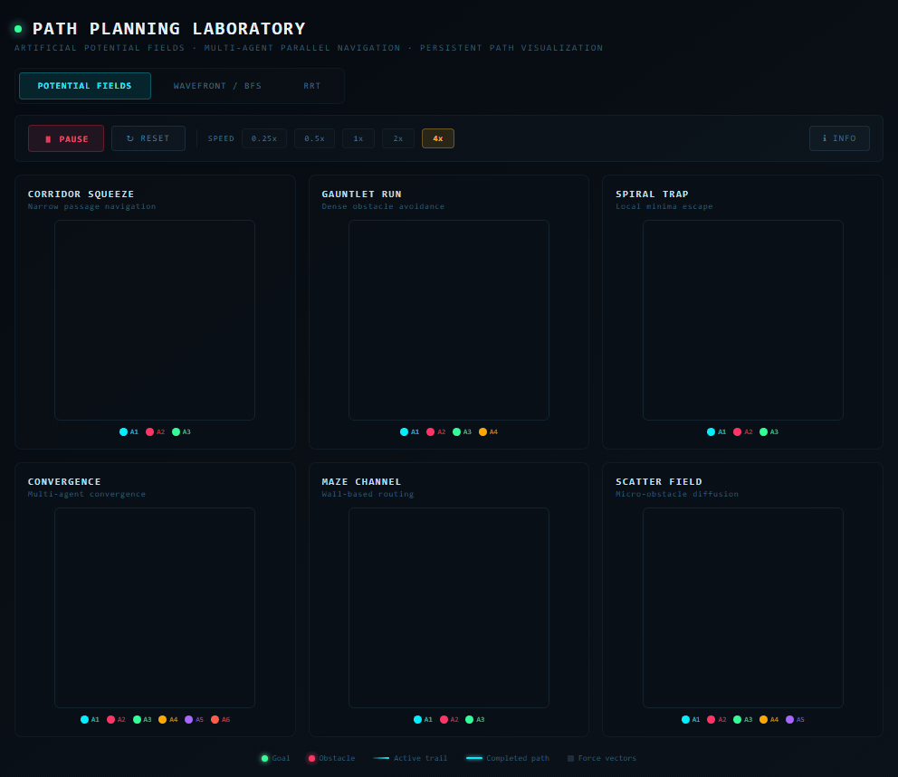
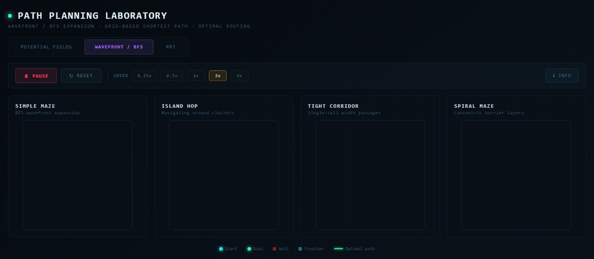
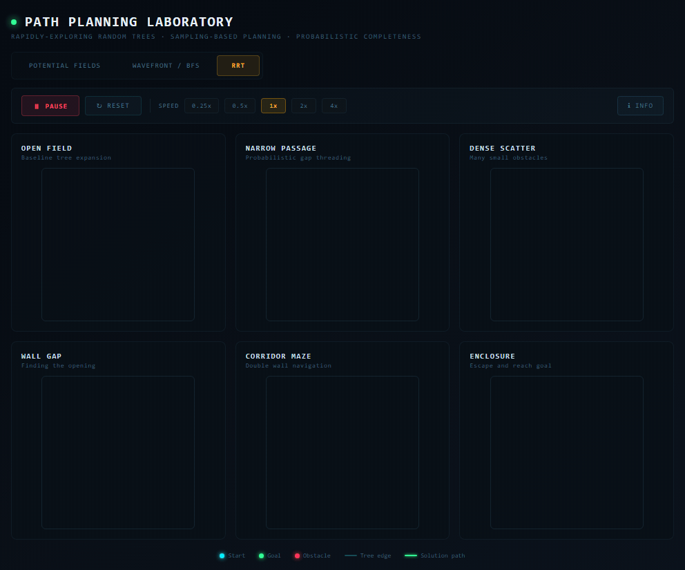
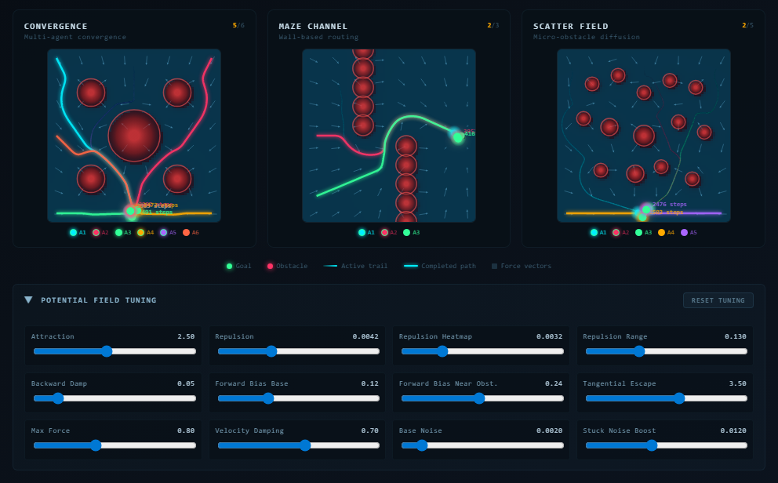

# Path Planning Laboratory

**[Live demo: redlynx101.github.io/pathing-lab](https://redlynx101.github.io/pathing-lab/)** (runs in the browser, nothing to install)

An interactive, browser-based visualization of classic path planning algorithms. Built for presentations, lectures, and hands-on learning environments where you want a live demo on screen rather than static slides.

Three algorithms run side-by-side across multiple obstacle scenarios so you can compare their behavior in real time.

## Algorithms

### Artificial Potential Fields



<sub>4x speed, time-lapse (every 10th frame), from reset until every agent reaches its goal.</sub>

Agents navigate by following the negative gradient of a potential function composed of an attractive field pulling toward the goal and repulsive fields pushing away from obstacles. Multiple agents run in parallel across six scenarios (corridor squeeze, gauntlet run, spiral trap, convergence, maze channel, scatter field). A full parameter tuning panel lets you adjust attraction/repulsion strength, repulsion range, backward damping, tangential escape force, velocity damping, noise levels, and more in real time.

**Key concepts:** gradient descent, attractive/repulsive potentials, local minima, vortex escape

### Wavefront / BFS



<sub>2x speed, from reset until all four grids have a shortest path.</sub>

Breadth-first search expands from the goal in concentric wavefronts on a 40x40 grid. Once the start cell is reached, the shortest path is traced back through parent pointers. Four grid scenarios demonstrate wall navigation, island hopping, tight corridors, and concentric spiral mazes. Guarantees optimal paths on uniform-cost grids.

**Key concepts:** BFS, wavefront expansion, shortest path, grid-based planning

### Rapidly-exploring Random Trees (RRT)



<sub>1x speed, from reset until all six trees reach their goals.</sub>

A sampling-based planner that builds a tree incrementally from the start position. Each iteration samples a random point in the space, finds the nearest existing tree node, and extends toward the sample if the path is collision-free. A small goal bias (8%) steers exploration. Six scenarios cover open fields, narrow passages, dense obstacle scatters, wall gaps, corridor mazes, and enclosed starts.

**Key concepts:** sampling-based planning, Voronoi bias, probabilistic completeness, collision checking

## Quick Start

```bash
git clone https://github.com/RedLynx101/pathing-lab.git
cd pathing-lab
npm install
npm run dev
```

Open [http://localhost:5173](http://localhost:5173) in your browser.

## Controls

| Control | Description |
|---|---|
| **Tab bar** | Switch between Potential Fields, Wavefront/BFS, and RRT |
| **Pause / Run** | Freeze or resume all simulations |
| **Reset** | Restart all scenarios from initial state |
| **Speed** | 0.25x, 0.5x, 1x, 2x, 4x playback speed |
| **Info** | Toggle algorithm description panel |
| **Tuning** | (Potential Fields only) Expand the bottom panel to adjust all algorithm parameters live |

## Project Structure

```
pathing-lab/
  app.jsx          # All algorithm implementations and UI (single-file app)
  index.html       # Entry HTML with dark theme base styles and the JetBrains Mono font
  vite.config.js   # Relative base path so the build works from any subpath
  package.json     # Dependencies (React 18, Vite 5)
  src/
    main.jsx       # React entry point
  docs/media/      # README GIFs and screenshots
  .github/workflows/
    deploy-pages.yml  # Builds and deploys to GitHub Pages on every push to main
  LICENSE          # MIT
  .gitignore
  README.md
```

## Deployment

The live demo is the production Vite build (`npm run build` writes `dist/`), deployed to GitHub Pages by [`.github/workflows/deploy-pages.yml`](.github/workflows/deploy-pages.yml) on every push to `main`. To try the production build locally, run `npm run build` and then `npm run preview`.

## Tunable Parameters (Potential Fields)



| Parameter | What it does |
|---|---|
| Attraction | Strength of the goal-pulling force |
| Repulsion | Strength of obstacle-pushing force on agents |
| Repulsion Heatmap | Strength used for the background potential visualization |
| Repulsion Range | How far from obstacle surfaces the repulsive field extends |
| Backward Damp | How much backward (away from goal) repulsion is suppressed |
| Forward Bias Base | Minimum forward force maintained near obstacles |
| Forward Bias Near Obst. | Additional forward bias when very close to obstacles |
| Tangential Escape | Strength of sideways force when agents get stuck |
| Max Force | Force magnitude cap |
| Velocity Damping | How quickly velocity decays each step (lower = more damping) |
| Base Noise | Random perturbation added every step |
| Stuck Noise Boost | Additional noise when an agent detects it is stuck |

## Tech

- **React 18** for UI state and component rendering
- **HTML Canvas** for all algorithm visualizations (no WebGL, no external chart libraries)
- **Vite 5** for dev server and bundling
- Zero runtime dependencies beyond React

## Use Cases

- **Classroom lectures** on robotics, AI, or motion planning
- **Conference presentations** as a live interactive demo
- **Self-study** for understanding how these algorithms behave under different obstacle configurations
- **Parameter exploration** to build intuition about potential field tuning

## License

[MIT](LICENSE)

---

Built by **Noah Hicks** & **Claude**
